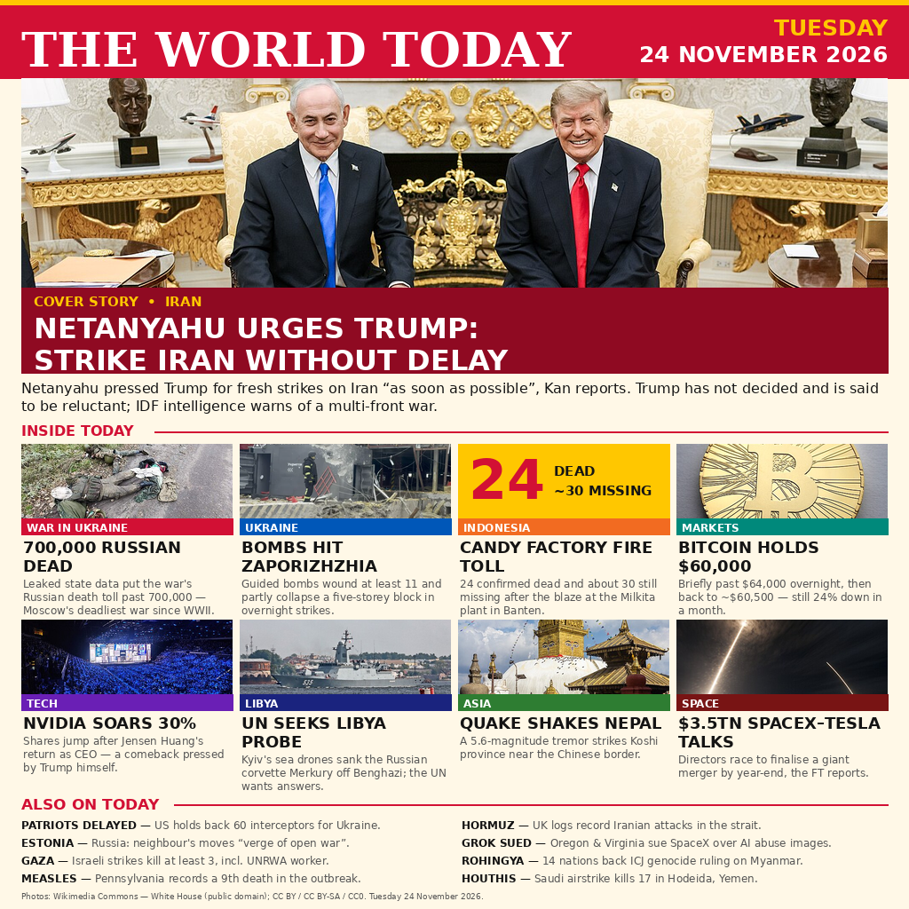

# Tuesday 24 November 2026 — The World in One Day (Magazine Cover)

Entry for the make.fun competition
[news-image-20261124](https://make.fun/bounty/news-image-20261124):
"Sum up 24 November's world news in one image".

Referral code: `5t0n7vxw`

## The image

A magazine cover: a bold red masthead ("THE WORLD TODAY") with the date —
"Tuesday 24 November 2026" — as a headline element, one dominant cover photo
of President Donald Trump with Prime Minister Benjamin Netanyahu, and the cover
headline "NETANYAHU URGES TRUMP: STRIKE IRAN WITHOUT DELAY" over the photo.
Below it, 8 feature tiles (each with a photo, a bold headline and a short
description) and an "ALSO ON TODAY" strip of 8 more stories. Bright,
attention-grabbing palette; legible at ~300px.

## Stories in the image

- **Cover — Netanyahu urges Trump to strike Iran "without delay".** Kan (Israel's
  public broadcaster) reports the Israeli PM pressed Trump for fresh US strikes
  "as soon as possible". Trump has not decided and is said to be reluctant; IDF
  intelligence warns a strike could ignite a multi-front war.
- **700,000 Russian dead.** Leaked Rosstat data analysed by Mediazona and Meduza
  put the war's Russian death toll past 700,000 — Moscow's deadliest war since WWII.
- **Bombs hit Zaporizhzhia.** Guided bombs wound at least 11 and partly collapse a
  five-storey block in overnight strikes on 24 November.
- **Candy factory fire toll (Indonesia).** 24 confirmed dead, about 30 still missing
  after the fire at the Milkita plant in Banten (fire on 21 Nov; toll confirmed 24 Nov).
- **Bitcoin holds $60,000.** Briefly past $64,000 overnight, then back to ~$60,500 —
  still 24% down in a month. (The two-year low of $55,130 was hit on 21 Nov, not today.)
- **Nvidia soars 30%.** Shares jump after Jensen Huang's return as CEO, announced
  23 November after Trump pressed the board over the weekend.
- **UN seeks Libya probe.** Kyiv's sea drones sank the Russian corvette Merkury off
  Benghazi (22 Nov); the UN wants answers.
- **Quake shakes Nepal.** A 5.6-magnitude tremor strikes Koshi province near the
  Chinese border.
- **$3.5tn SpaceX–Tesla talks.** Directors race to finalise a giant merger by
  year-end, the FT reports.
- **Also on today:** US holds back 60 Patriot interceptors for Ukraine; record
  Iranian attacks in the Strait of Hormuz; Russia warns Estonia's moves are on the
  "verge of open war"; Oregon and Virginia sue SpaceX over Grok-generated abuse
  images; Israeli strikes kill at least 3 in Gaza, incl. an UNRWA worker;
  14 nations back the ICJ genocide ruling on Myanmar; a 9th measles death in
  Pennsylvania; a Saudi airstrike kills 17 in Hodeida, Yemen.

## How it works

`main.py` is standard library only: it validates the PNG header (signature and
IHDR dimensions must be exactly 1024×1024, file at most 1 MiB) and copies
`entry.png` to `$MAKEFUN_OUTPUT_DIR/entry.png`, verifying the copied size.
`render.py` (Pillow, local build only) drew the image from the photos in
`photos/`; it is included for transparency and is not used by `main.py`.

## Photo credits

All photos from Wikimedia Commons, free licences (see `photos/credits.json`):

- Cover: President Donald Trump meets Prime Minister Benjamin Netanyahu in the
  Oval Office, 28 July 2026. Official White House Photo by Daniel Torok /
  public domain.
- Russian soldiers near Lyman, 2022 (file photo, CC BY 4.0); destruction in
  Zaporizhzhia after a Russian attack, March 2026 (file photo, CC BY 4.0);
  a physical Bitcoin coin (CC BY-SA 3.0); Jensen Huang at Nvidia's CES 2025
  keynote (CC BY-SA 4.0); the Russian corvette Merkury before the attack
  (CC BY 4.0); Swayambhunath Stupa, Kathmandu (CC BY-SA 4.0); a Falcon 9
  launch (CC0, file photo).
